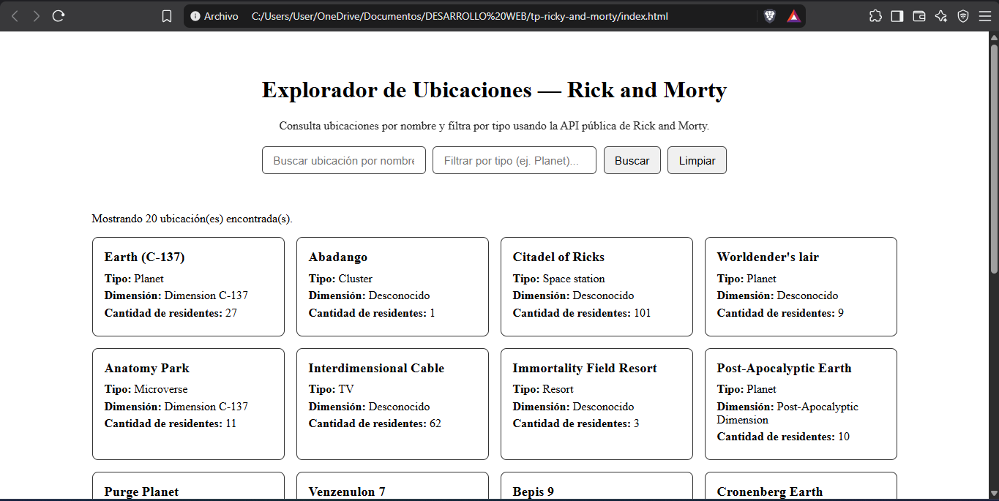

# Explorador de Ubicaciones · Rick and Morty

Aplicación web interactiva desarrollada en HTML5, CSS3 y JavaScript (ES6+) que consume la API pública de Rick and Morty (`/api/location`) para buscar ubicaciones por nombre y filtrarlas por tipo, mostrando sus datos clave de forma clara y manejando respuestas sin coincidencias.

**Autor:** Fabricio Sotelo · Fundamentos de Desarrollo Web · UCSA
**Variante del TP:** B

## Sitios publicados
- GitHub Pages: https://fbrisotelo-sun.github.io/tp-sotelo-fabricio/
- Vercel / Netlify: https://tp-sotelo-fabricio.vercel.app

## Captura


## Funcionalidades
- Consulta de ubicaciones desde `https://rickandmortyapi.com/api/location` mediante `fetch`.
- Búsqueda por nombre (`?name=...`) y filtro por tipo (`?type=...`), combinables y limpiables.
- Visualización de tarjetas con nombre, tipo, dimensión y cantidad de residentes (`residents.length`).
- Tratamiento de respuestas `404` como «sin resultados» y normalización de valores vacíos o `unknown` como «Desconocido».

## Tecnologías
- HTML5, CSS3, JavaScript (ES6+), Fetch API, API de Rick and Morty.

## Estructura del proyecto
```text
tp-sotelo-fabricio/
├── index.html          # Interfaz principal, filtros y pie de página (Versión 1.1)
├── README.md           # Documentación del proyecto, variante y enlaces publicados
├── .gitignore          # Archivos excluidos del control de versiones
├── css/
│   └── estilos.css     # Estilos de disposición y tarjetas de ubicaciones
├── js/
│   └── app.js          # Peticiones a la API de ubicaciones, filtros y renderizado
└── img/
    └── captura.png     # Captura usada en el README